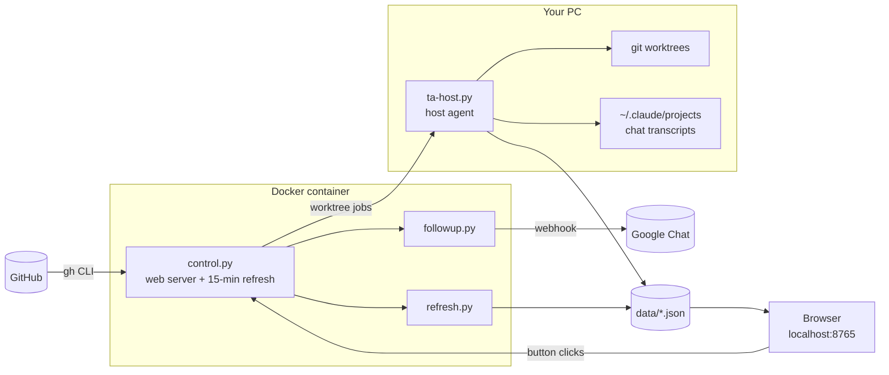

# Ticket Arena

A personal dashboard for your tickets, PRs and Claude Code chats. It runs on your own PC and reads GitHub with your own `gh` login, so every developer sees their own work.

> [!NOTE]
> **SCREENSHOT TODO** `docs/images/01-overview.png`
> Capture: the top of the dashboard (header and the six summary counters). Details in [docs/SCREENSHOTS.md](docs/SCREENSHOTS.md).

**Setting it up?** Go to **[SETUP.md](SETUP.md)**. It takes about 10 minutes.

---

## Why use it

- **See every ticket's stage at a glance**: in review, merged, promoting to staging, or on staging.
- **Never miss a review comment**: comments nobody has answered yet are flagged.
- **Stop chasing reviewers by hand**: it posts "please review" reminders to Google Chat on a timer and stops when the PR merges.
- **Know when a Claude chat is too full**: every Claude Code chat gets a context meter that says keep going, wrap up, or start a new chat.
- **Create and remove worktrees with one click.**
- **Costs no Claude tokens.** It only uses `gh`, `git`, a Chat webhook and local files.

---

## Feature tour

### Header and summary counters

The header shows your repo and GitHub username, a one-line summary, and a **Refresh now** button. Below it are six counters: **In review**, **Merged to main**, **Promoting**, **On staging**, **Needs your reply** and **Stuck**. Data refreshes from GitHub every 15 minutes by itself.

### Danger zone: stuck tickets

A ticket is stuck when its PR has been open in review, or open for promotion to staging, longer than the limit (2 days by default). Each alert shows how many days it has been, since when, and whether changes were requested.

> [!NOTE]
> **SCREENSHOT TODO** `docs/images/02-stuck-tickets.png`
> Capture: the Danger zone with at least one red stuck-ticket card.

### Round 1: Ticket progress

One row per ticket, taken from your PR titles (`EDGE-123: ...`). Each row shows:
- the furthest stage reached, as a progress bar: review, merged, promoting, staging. A teammate's "Promote #PR" PR counts too
- days in that stage against the limit
- the latest PR, lines changed and the last update

Use **Show** to filter and **Sort** to reorder. Click a row to load that ticket into Combo moves.

> [!NOTE]
> **SCREENSHOT TODO** `docs/images/03-ticket-progress.png`
> Capture: the Ticket progress table with tickets at different stages, plus the Show and Sort controls.

### Round 2: PR comments and follow-ups

**Follow-ups.** One switch turns on automatic "please review" posts to your Google Chat space. Each open PR gets a post on a timer. The post tags the people in your always-cc list and the PR's reviewers. A PR drops off as soon as it merges, and drafts and promotion PRs are left out. Each PR also has **Skip** / **Unskip**, **Post now**, and shows when it was last posted.

> [!NOTE]
> **SCREENSHOT TODO** `docs/images/04-follow-ups.png`
> Capture: the Follow-ups switch (ON) and the list of PRs below it.

**Comments.** Review comments and review summaries on your open PRs. Each one is tagged with a severity (Blocking, High, Changes, Medium, Issue, Nit, Low, Note, Approve). Comments nobody has replied to are flagged **needs reply**. Bot comments are shortened to one line. You can filter by needs reply, severity or reviewer, and sort by newest, oldest, most severe, reviewer or PR.

> [!NOTE]
> **SCREENSHOT TODO** `docs/images/05-pr-comments.png`
> Capture: a few comment cards, including at least one flagged "needs reply".

### Round 4: Team PRs

Open PRs from everyone in your team list (`chat-people.json`). Badges tell you where you're needed:
- **Asks you**: your review was requested
- **You: approved / commented**: your own review state
- **replied to you**: someone answered your review comment or @mentioned you. Click it to jump to the reply.

Filters include: hide drafts, promotions or approved PRs; only "replied to me", "asks for my review" or "not reviewed by me".

> [!NOTE]
> **SCREENSHOT TODO** `docs/images/06-team-prs.png`
> Capture: the Team PRs table with an "Asks you" badge and a pink "replied to you" badge visible.

**Review drafts (optional, uses Claude).** **Draft review** asks a Claude Code session to write review comments for a PR. You untick any you don't want, then press **Post** to send them to GitHub as one review from you, or **Discard**. Nothing is posted without your click. See [SETUP.md, Claude review drafts](SETUP.md#8-optional-claude-review-drafts).

> [!NOTE]
> **SCREENSHOT TODO** `docs/images/07-review-draft.png`
> Capture: a ready review draft card with its comment checkboxes and the Post / Discard buttons.

### Round 5: Worktrees and the context meter

- **Create worktree**: type a ticket and press the button. It runs your worktree command (plain `git worktree add`, or your own script), and its progress shows live on the page.
- **Remove worktree**: asks you to confirm first. It refuses if the worktree has uncommitted changes, and keeps the branch.
- **One card per worktree**: branch, PR stage, uncommitted file count, and the Claude Code chats that worked on it.

> [!NOTE]
> **SCREENSHOT TODO** `docs/images/08-worktrees.png`
> Capture: the Worktrees section: the Create worktree bar with "Host agent live", and two or three worktree cards.

**Context meter.** Every Claude Code chat gets one:

| Verdict | When | What to do |
|---|---|---|
| **Keep going** | under 200K tokens | Carry on. It also estimates how many more prompts fit, based on how fast this chat grows. |
| **Wrap up** | 200K to 350K | Finish the current step, then start the next task in a new chat. |
| **Start a new chat** | over 350K | Ask Claude for a handoff summary, then start a new chat. |
| **Just compacted** | right after an auto-compact | Earlier details are now a summary. For new work, a fresh chat is cleaner. |

The bar shows tokens used out of the context window. It has marks at both limits, plus a dotted line where your own chats usually auto-compact. Each chat also shows its prompt count and number of compactions, a green dot if it was active in the last 10 minutes, and a copy button for `claude --resume`. You can change the limits in `config.json`.

> [!NOTE]
> **SCREENSHOT TODO** `docs/images/09-context-meter.png`
> Capture: a close-up of one worktree card with a "Wrap up" or "Start a new chat" chat, so the meter, its marks and the verdict text are readable.

### Round 3: Combo moves

Pick a ticket or PR, then copy a ready-made command:

| Move | Command |
|---|---|
| Start ticket | `/start-ticket <ticket>` |
| Resolve PR | `/resolve-pr-ticket <ticket>` |
| Auto-guard | `/loop 30m /resolve-pr-ticket <ticket>` |
| Self review | `/code-review high <pr>` |
| Watch checks | `gh pr checks <pr> --watch` |
| Unresolved threads | `gh pr view <pr> --comments` |

The slash commands need the matching Claude Code skills.

> [!NOTE]
> **SCREENSHOT TODO** `docs/images/10-combo-moves.png`
> Capture: the Combo moves cards with a ticket and PR filled in.

---

## How it works

| File | Role |
|---|---|
| `ta.sh` | One command for everything: `up`, `down`, `restart`, `status`, `logs` |
| `control.py` | Local web server on `127.0.0.1:8765`. It serves the dashboard, runs the GitHub refresh on a timer, and handles button clicks (each needs a secret key) |
| `refresh.py` | Pulls your PRs, comments and team PRs with `gh`, then writes `data/*.json` |
| `followup.py` | Posts follow-ups to a Google Chat webhook. Also works as a command-line tool |
| `ta-host.py` | Host agent, runs on your PC rather than in Docker. Lists worktrees, measures how full each Claude chat is, and runs worktree jobs |
| `index.html`, `ta-local.js` | The dashboard page |
| `config.py` | Loads `config.json`. Your GitHub username comes from `gh`, never from the config |
| `drafts.py`, `DRAFTING.md` | Optional Claude review drafts |
| `chat-scrape.js`, `import_chat_ids.py` | Optional helpers to collect Google Chat user IDs for @mentions |

## FAQ

**Does it use Claude tokens?** No. Two optional features (`autoDraft`, `notifyClaude`) do, and both are off by default. See [Token use](SETUP.md#token-use).

**Does it post anything as me?**
- Follow-ups go to Google Chat through the space's webhook, so they appear under the webhook's name, not yours.
- Review drafts reach GitHub as you, but only when you press **Post**.
- Nothing else writes to GitHub.

**Can other people open my dashboard?** No. It only listens on `127.0.0.1`, and every button needs a secret key that's created on your PC.

**Will teammates see my settings?** No. Your settings and secrets (`config.json`, `gchat-webhook`, `control-token`, `chat-people.json`, `data/`) are git-ignored, so each person keeps their own.
